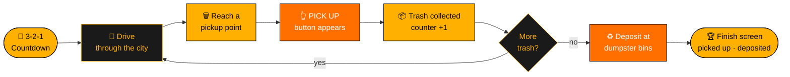

<p align="center">
  
</p>

<p align="center">
  
</p>

<p align="center">
  
  
  
  
  
</p>

---

<h2 align="center">🏙️ THE JOB</h2>

<p align="center">
You're the city's garbage truck driver. 🚚<br/>
Wait for the <b>countdown</b>, then hit the road through a <b>low-poly city</b>,<br/>
stop at each <b>trash pickup point</b>, load up, and haul it all to the <b>dumpster bins</b>.<br/>
Your pickups and deposits are tallied on the <b>finish screen</b>.
</p>

---

<h2 align="center">🔁 GAMEPLAY LOOP</h2>



---

<p align="center">
  
</p>

---

<h2 align="center">🎮 CONTROLS</h2>

<table align="center">
<tr><th>Action</th><th>Keys</th></tr>
<tr><td>⬆️ Accelerate / ⬇️ Reverse</td><td><kbd>W</kbd> <kbd>S</kbd> / <kbd>↑</kbd> <kbd>↓</kbd></td></tr>
<tr><td>↔️ Steer</td><td><kbd>A</kbd> <kbd>D</kbd> / <kbd>←</kbd> <kbd>→</kbd></td></tr>
<tr><td>🛑 Brake</td><td><kbd>B</kbd></td></tr>
<tr><td>🗑️ Pick up trash</td><td>On-screen <b>PICK UP</b> button</td></tr>
</table>

---

<h2 align="center">🧠 UNDER THE HOOD</h2>

| Script | Role |
|:--|:--|
| `PlayerController.cs` | 🚚 Wheel colliders, engine force, braking, steering, pickup/deposit logic, HUD and finish screen |
| `TimerScrip.cs` | 🚦 Start countdown that locks the engine until "GO" |
| `MyCarSound.cs` | 🔊 Engine audio pitch control |

---

<h2 align="center">🚀 RUN IT</h2>

```bash
git clone https://github.com/vishwaMoger/Dump_Truck.git
```

1. Open the folder in **Unity 2022.3**.
2. Open `Assets/Scenes/SampleScene.unity`.
3. Press ▶️ **Play**.

---

<p align="center">
  <b>Made with ❤️ and 🚚 by <a href="https://github.com/vishwaMoger">Vishwa Moger</a></b><br/>
  <sub>Game Developer · 3+ years · Bangalore, India</sub>
</p>


